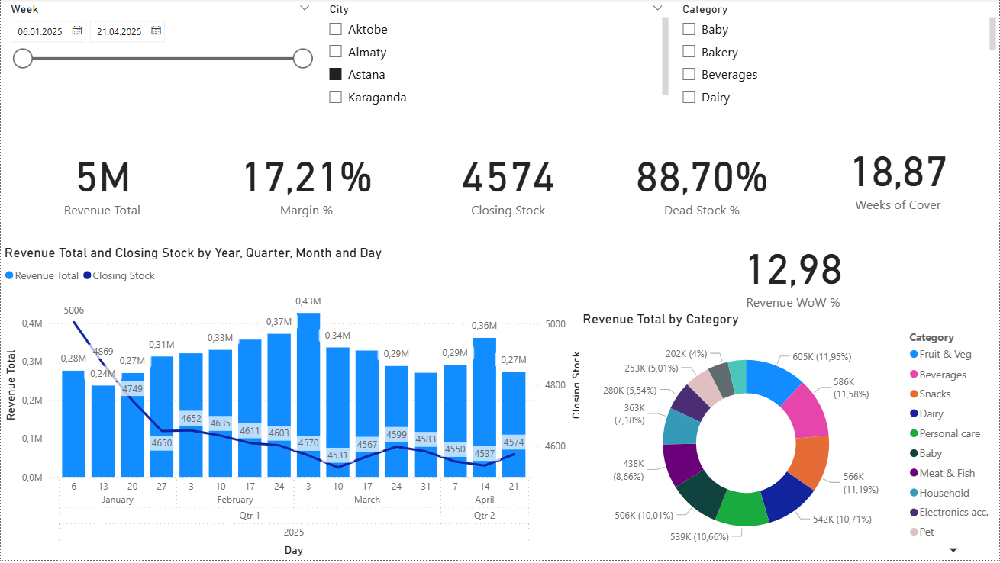
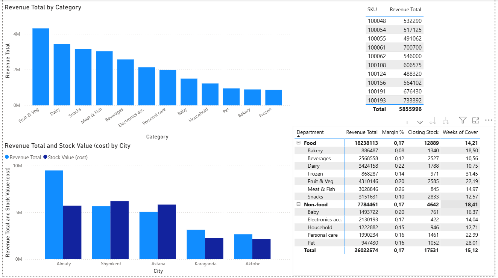
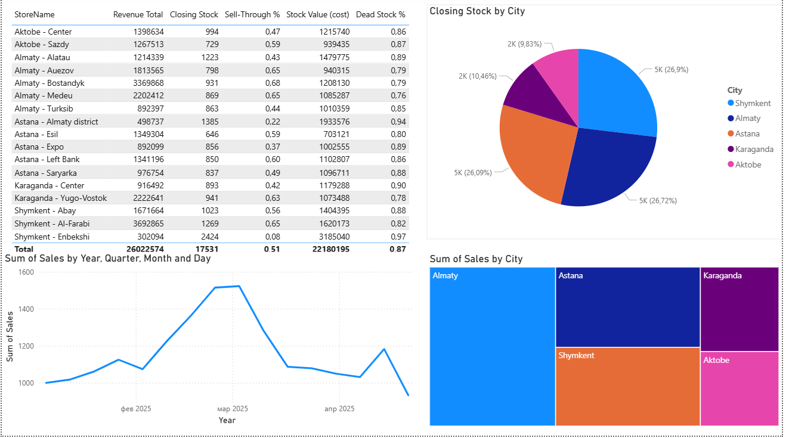

# Анализ продаж и остатков онлайн-ритейла
Учебный проект на **синтетических данных**: Excel + Power BI.
## Задача
Проанализировать продажи и остатки по магазинам и товарам, найти риски избытка и дефицита запасов.
## Данные
16 недель, 17 магазинов в 5 городах, 195 товаров в 12 категориях. Данные созданы искусственно, содержат намеренные ошибки (дубликаты, пропуски, отрицательные остатки, неверные SKU).

## Что сделано
**Excel:** очистка данных (лог ошибок), Power Query, формулы ВПР/СУММЕСЛИМН, сводные таблицы со срезами, выводы.
**Power BI:** модель данных, меры (выручка, маржа, sell-through, покрытие, мёртвый запас), 3 страницы дашборда.

## Ключевые выводы
- Продано 18 551 шт. на 26,0 млн ₸, маржа 17,3%.
- 87% остатков приходится на товары без продаж (≈19 млн ₸ заморожено).
- Алматы даёт 36,5% выручки при покрытии 11 недель; магазины 2012 и 2003 держат избыточный запас.
- Пик продаж в феврале–марте (+45% к январю), остатки на него не реагируют.

## Скриншоты

## Файлы
- `Retail_Source_Data.xlsx`: анализ в Excel
- `dashboard.pbix`: отчёт Power BI
